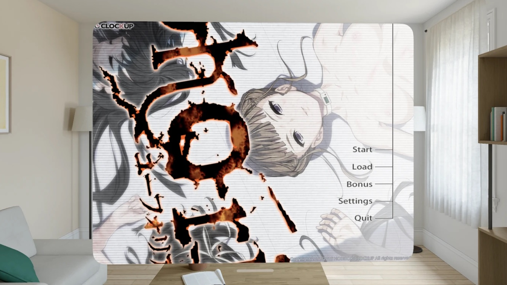
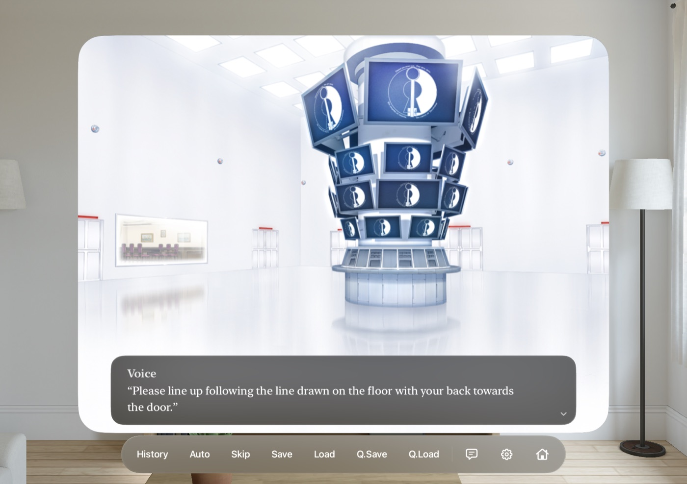
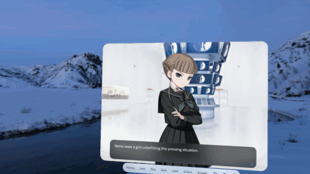
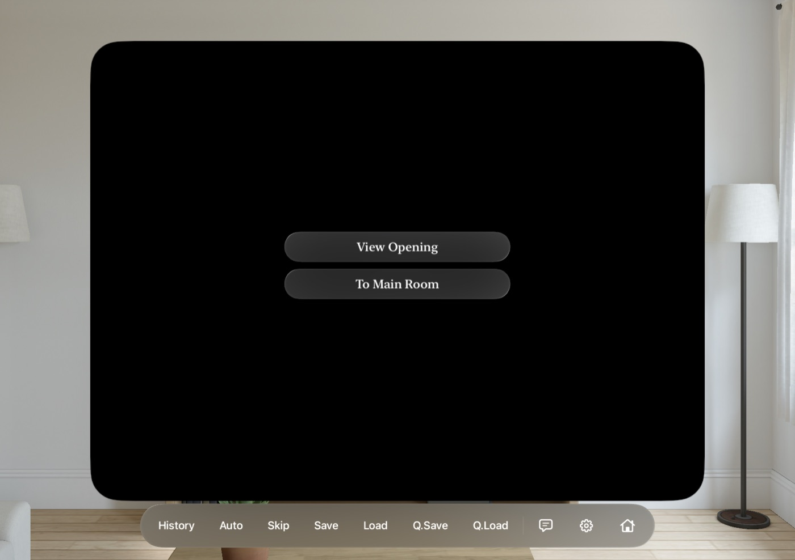
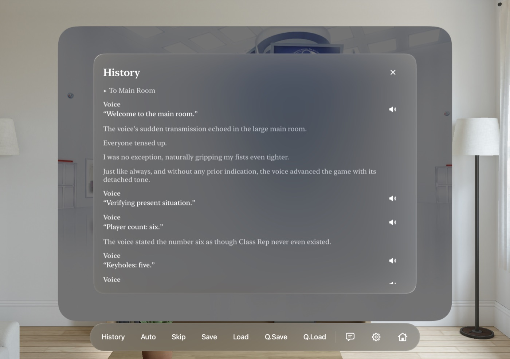
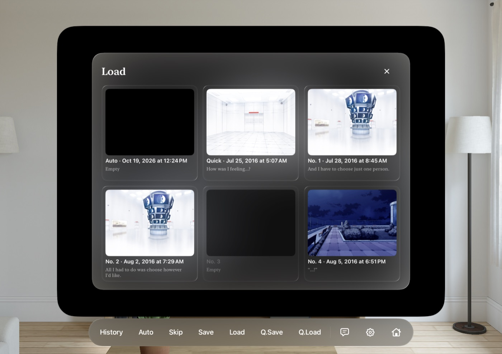
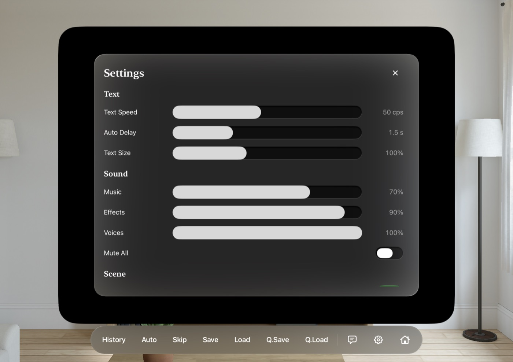

# Euphoria for Apple Vision Pro

A native visionOS app that plays your own copy of **Euphoria** (the MangaGamer English PC release). It runs the original story in Swift and SwiftUI.

This repository holds **only the build kit**: Swift source, the conversion tools and docs. **It does not include any game files.** You need your own legal copy of the PC game. The build scripts extract and convert its assets on your Mac.



## Features

### Story playback in a native visionOS window

The game runs in a rounded 4:3 window on the original's 1024×768 stage. Dialogue appears in a glass panel, and characters float in depth in front of the background. The controls sit in an ornament under the window: History, Auto, Skip, Save, Load, Quick Save, Quick Load, hide text, Settings and Title.



### Spatial scenes

Full-screen backgrounds and event CGs become visionOS spatial scenes behind the window, generated on the device. Move your head and the room has real depth behind the characters. Upcoming pictures are queued and generated ahead, so most are ready by the time the story reaches them. Flashback scenes keep their sepia tint, and event CGs that show as spatial scenes change at once instead of fading. Settings › Spatial Scenes turns them off.



### Choices

The original's branches, variables and jumps are interpreted directly, so every route and all six endings play. Text choices appear as glass buttons. The heroine selection screen uses the original's art.



### History with voice replay

A scrolling backlog of every line, with the choices you took marked. Tap the speaker icon on a voiced line to hear it again.



### Save and load

30+ slots with thumbnails and the saved line, plus quick save and an autosave on every line. You can also import your PC saves (see [Importing PC saves](#importing-pc-saves)).



### Settings

Text speed, auto delay, text size, the original's skip options (only skip already-read text, keep skipping after choices), separate music, effects and voice volumes, mute, the original's content options (gory, waste matter and orgasm expression CG variants), and scene options such as spatial scenes.



### Also included

- **Effects at the original's timing.** Sprite tweens and easing, quakes, flashes, fades, and rule-mask transitions (a Metal shader).
- **Bonus menu.** CG gallery, scene replay, music room and staff comments. It opens after your first ending, as in the original. Pictures, scenes and comments unlock as you play or by importing the PC's `gsd.sd`; every music track is open, as in the original. Gallery and scene replay group entries by character, as the original does, using its character tiles on a scrolling glass slab. The gallery has a Spatial on/off switch, and music replay has a now-playing bar. Settings › Classic Bonus Menu switches to the original PC layout.
- **Movies.** The opening and five ending movies, converted to H.264.

## Requirements

- A Mac with Apple silicon, and about **12 GB** of free disk space.
- **Xcode 26 or later** with the visionOS SDK. The project targets visionOS 26.0.
- Python 3.9+ (standard library only, no `pip install`).
- Your own copy of **Euphoria** (MangaGamer English PC release). You need its install folder: `euphoria.exe`, `pac/` and optionally `save/`.
- An **Apple Vision Pro** with Developer Mode on (*Settings › Privacy & Security › Developer Mode*), paired with your Mac in Xcode.
- An Apple developer account. A free one works for personal installs.

## Build

### 1. Put the game in place

Copy your installed game folder to `original/Euphoria/`, so that this file exists:

```
original/Euphoria/pac/bn.ypf
```

`original/`, `extracted/` and the generated `Resources/Game/` are in `.gitignore`. Game data never gets committed.

### 2. Extract and convert

Run these from the repository root:

```sh
# Unpack the six YPF archives (about 2.5 GB)
for a in bn cg cgsys se sn vo; do
  python3 tools/ypf_extract.py original/Euphoria/pac/$a.ypf extracted/$a
done

# Compile the 457 scenario scripts into the app's story JSON
python3 tools/build_story.py extracted/bn/ysbin extracted visionOS/Euphoria/Resources/Game

# Link the art and audio into the app bundle folder (hard links, no extra disk)
python3 tools/package_assets.py extracted visionOS/Euphoria/Resources/Game

# visionOS can't play Ogg: convert voice, SE and BGM to AAC (several minutes)
tools/convert_audio.sh visionOS/Euphoria/Resources/Game

# Convert the MPEG-1 movies to H.264 MP4
tools/convert_movies.sh original/Euphoria/pac visionOS/Euphoria/Resources/Game

# Generate the Xcode project
python3 tools/create_xcode_project.py
```

### 3. Set up signing

Generate the project with your team ID and a bundle ID of your own. Your team ID is in Xcode › *Settings › Accounts*, or at developer.apple.com under *Membership*.

```sh
DEVELOPMENT_TEAM=ABCDE12345 BUNDLE_ID=com.yourname.euphoria python3 tools/create_xcode_project.py
```

`create_xcode_project.py` rewrites the project file. Run it again with the same variables after you add a `.swift` file. Signing changes made in Xcode's UI are lost when it runs.

### 4. Build and install on your Vision Pro

**Xcode:** open `visionOS/Euphoria.xcodeproj`, pick the *Euphoria* scheme, choose your Apple Vision Pro as the run destination, then Run. The app bundle is about 3 GB, so the first install takes a while.

**Command line:**

```sh
xcodebuild -project visionOS/Euphoria.xcodeproj -scheme Euphoria \
  -destination 'generic/platform=visionOS' -derivedDataPath .build/DeviceData \
  -allowProvisioningUpdates build
xcrun devicectl list devices
xcrun devicectl device install app --device "Apple Vision Pro" \
  .build/DeviceData/Build/Products/Debug-xros/Euphoria.app
xcrun devicectl device process launch --device "Apple Vision Pro" com.yourname.euphoria
```

Use your headset's name or identifier from `devicectl list devices`. With a free developer account, the app expires after 7 days. Build and install again to renew it. Your saves stay on the headset.

If the headset shows *Untrusted Developer*, go to *Settings › General › VPN & Device Management* and trust your developer certificate.

## Importing PC saves

Install and open the app once, then convert your PC saves and copy them to the headset:

```sh
python3 tools/import_saves.py original/Euphoria/save visionOS/Euphoria/Resources/Game/story imported-saves
xcrun devicectl device copy to --device "Apple Vision Pro" \
  --domain-type appDataContainer --domain-identifier com.yourname.euphoria \
  --source imported-saves/Saves --source imported-saves/globals.json --source imported-saves/progress.json \
  --destination Documents
```

This converts `saveNNNNN.sd` into slot N. `save10001` becomes the quick save and `save3000N` becomes slot 110+N. It also imports the global flags and the gallery, replay and music unlocks from `gsd.sd`. The app replays the saved scene silently up to the saved line, which rebuilds the background, characters and music. About 98 of 105 test saves import. You can also copy the files with Xcode: *Window › Devices* › your Vision Pro › the app › *Replace Container*.

## How it works

| Piece | File | Role |
| --- | --- | --- |
| Archive extractor | [tools/ypf_extract.py](tools/ypf_extract.py) | Unpacks YU-RIS `.ypf` archives (NOT-encoded names, zlib entries). |
| Bytecode reader | [tools/yuris.py](tools/yuris.py) | Decodes YSTB scripts (XOR key `0x30731B78`, reverse-Polish expressions). |
| Story converter | [tools/build_story.py](tools/build_story.py) | Writes compact JSON: text, `IF`/`GO`, variables, framework calls, asset index, BGM and name tables. |
| Interpreter | [StoryEngine.swift](visionOS/Euphoria/StoryEngine.swift) | Runs the JSON: branches, variables, choices, saves, auto and skip. |
| ERIS framework | [Eris.swift](visionOS/Euphoria/Eris.swift) | About 50 calls the story makes: `MAC.BG`/`EV`/`FOUT`/`FIN`/`FLASH`, the `es.SP.*` sprite builder, `es.SND`, choices, heroine selection. |
| Stage | [Stage.swift](visionOS/Euphoria/Stage.swift), [StageView.swift](visionOS/Euphoria/StageView.swift), [Shaders.metal](visionOS/Euphoria/Shaders.metal) | Layers, tweens, rule-mask transitions. |
| UI | [GameView.swift](visionOS/Euphoria/GameView.swift), [Panels.swift](visionOS/Euphoria/Panels.swift), [Extras.swift](visionOS/Euphoria/Extras.swift), [BonusRoom.swift](visionOS/Euphoria/BonusRoom.swift) | Window, dialogue, ornament, panels, bonus menu. |
| Spatial | [SpatialScenes.swift](visionOS/Euphoria/SpatialScenes.swift) | On-device spatial scenes for full-screen art. |
| Audio / saves | [AudioDirector.swift](visionOS/Euphoria/AudioDirector.swift), [Persistence.swift](visionOS/Euphoria/Persistence.swift) | Sound channels; slots, globals, unlocks. |

Optional: `python3 tools/ybn_decompile.py extracted/bn/ysbin decompiled` writes readable YU-RIS-style source for every script. It helps when you investigate a behavior, but the build doesn't need it.

## Testing

```sh
python3 tools/explore_routes.py visionOS/Euphoria/Resources/Game/story            # every route, as a new player
python3 tools/explore_routes.py visionOS/Euphoria/Resources/Game/story --replays  # every scene replay and staff comment
```

This is a headless copy of the interpreter. It takes every choice and reports unreached scripts, endings, movies, unknown labels and dead ends. The last run reached 456 of 457 scripts (the staff commentary is reachable from the Bonus menu only) and all six movies, with no problems. All 78 replays end cleanly.

### Debug launch arguments (Debug builds)

`-autostart YES` · `-startLabel 00_op_02` · `-loadSlot slot33` · `-autoAdvance 0.5` · `-choices 0,1` · `-skip YES` · `-traceLines YES` · `-traceSound YES` · `-panel history|save|load|settings|gallery|replays|music|staff` · `-textHidden YES` · `-titleExtras YES` · `-viewGallerySet 0` · `-bonusGroup 3` · `-playTrack 0` · `-replay RP_nem_h01` · `-playMovie op`

Add them in Xcode under *Product › Scheme › Edit Scheme › Run › Arguments*, or after the bundle ID in `xcrun devicectl device process launch`. Logs go to `Documents/debug.log` in the app container. Download it with `xcrun devicectl device copy from --domain-type appDataContainer --domain-identifier <bundle id> --source Documents/debug.log --destination .`

## Known gaps

- Blend modes, skew and the bonus-game counters aren't implemented yet. Blur and the continuous shake are approximations.
- Spatial scenes need more testing on hardware.
- Some PC saves don't import: a few sit at a menu reached through a jump the importer doesn't follow.
- Gaze and pinch targets need more tuning.

## Working with an AI agent

See [AGENT.md](AGENT.md) for the build, the architecture rules and the do-nots, written for coding agents (Claude Code, Codex, Cursor, …).

## Legal

This is an unofficial fan project and is not affiliated with CLOCKUP or MangaGamer. It contains no game assets, scripts or text. Use it only with a copy of the game you own, and don't distribute builds that contain game data.
