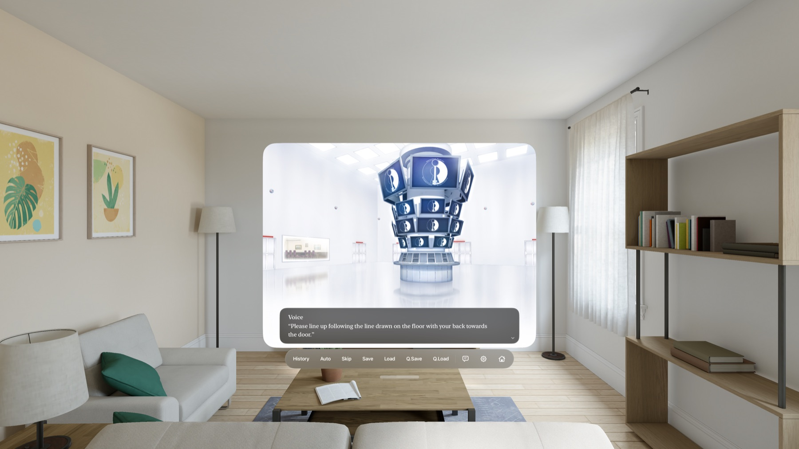

# Euphoria for Apple Vision Pro

A native visionOS app that plays your own copy of **Euphoria** (the MangaGamer English PC release). It runs the original story in Swift and SwiftUI. There is no Ren'Py, no web view and no Windows engine.

This repository holds **only the build kit**: Swift source, the conversion tools and docs. **It does not include any game files.** You need your own legal copy of the PC game. The build scripts extract and convert its assets on your Mac.



> All screenshots are real captures from the visionOS simulator running this app. They show the UI on backgrounds only. No event CGs are shown.

## Features

### Story playback in a native visionOS window

The game runs in a rounded 4:3 window on the original's 1024×768 stage. Dialogue appears in a glass panel, and characters float in depth in front of the background. The controls sit in an ornament under the window: History, Auto, Skip, Save, Load, Quick Save, Quick Load, hide text, Settings and Title.


### Choices

The original's branches, variables and jumps are interpreted directly, so every route and all six endings play. Text choices appear as glass buttons. The heroine selection screen uses the original's art.


### History with voice replay

A scrolling backlog of every line, with the choices you took marked. Tap the speaker icon on a voiced line to hear it again.


### Save and load

30+ slots with thumbnails and the saved line, plus quick save and an autosave on every line. You can also import your PC saves (see [Importing PC saves](#importing-pc-saves)).


### Settings

Text speed, auto delay, text size, separate music, effects and voice volumes, mute, and scene options such as spatial scenes.


### Also included

- **Effects at the original's timing.** Sprite tweens and easing, quakes, flashes, fades, and rule-mask transitions (a Metal shader).
- **Spatial scenes.** Full-screen backgrounds and event CGs can become visionOS spatial scenes behind the window. They are generated on the device. Settings › Spatial Scenes turns them off.
- **Bonus menu.** CG gallery, scene replay, music room and staff comments, unlocked as you play or by importing the PC's `gsd.sd`.
- **Movies.** The opening and five ending movies, converted to H.264.

## Requirements

- A Mac with Apple silicon, and about **12 GB** of free disk space.
- **Xcode 26 or later** with the visionOS SDK. The project targets visionOS 26.0.
- Python 3.9+ (standard library only, no `pip install`).
- Your own copy of **Euphoria** (MangaGamer English PC release). You need its install folder: `euphoria.exe`, `pac/` and optionally `save/`.
- To run on a headset: an Apple Vision Pro and an Apple developer account (a free one works for personal installs).

## Build

### 1. Put the game in place

Copy your installed game folder to `original/Euphoria/`, so that this file exists:

```
original/Euphoria/pac/bn.ypf
```

`original/`, `extracted/` and the generated `Resources/Game/` are in `.gitignore`. Game data never gets committed.

### 2. Extract and convert

Run these from the repository root:

```sh
# Unpack the six YPF archives (about 2.5 GB)
for a in bn cg cgsys se sn vo; do
  python3 tools/ypf_extract.py original/Euphoria/pac/$a.ypf extracted/$a
done

# Compile the 457 scenario scripts into the app's story JSON
python3 tools/build_story.py extracted/bn/ysbin extracted visionOS/Euphoria/Resources/Game

# Link the art and audio into the app bundle folder (hard links, no extra disk)
python3 tools/package_assets.py extracted visionOS/Euphoria/Resources/Game

# visionOS can't play Ogg: convert voice, SE and BGM to AAC (several minutes)
tools/convert_audio.sh visionOS/Euphoria/Resources/Game

# Convert the MPEG-1 movies to H.264 MP4
tools/convert_movies.sh original/Euphoria/pac visionOS/Euphoria/Resources/Game

# Generate the Xcode project
python3 tools/create_xcode_project.py
```

### 3. Build and run

**Xcode:** open `visionOS/Euphoria.xcodeproj` and pick the *Euphoria* scheme. Choose an Apple Vision Pro simulator or your headset, then Run. For a headset, set your team and a bundle ID of your own (see the note below).

**Command line (simulator):**

```sh
xcodebuild -project visionOS/Euphoria.xcodeproj -scheme Euphoria -sdk xrsimulator \
  -derivedDataPath .build/DerivedData CODE_SIGNING_ALLOWED=NO build
xcrun simctl install booted .build/DerivedData/Build/Products/Debug-xrsimulator/Euphoria.app
xcrun simctl launch booted com.euphoria.vision
```

`create_xcode_project.py` rewrites the project file. If you add a `.swift` file, run it again. Signing changes you make in Xcode are lost when it runs, so pass them to the script instead:

```sh
DEVELOPMENT_TEAM=ABCDE12345 BUNDLE_ID=com.yourname.euphoria python3 tools/create_xcode_project.py
```

## Importing PC saves

Run the app once, then:

```sh
python3 tools/import_saves.py original/Euphoria/save visionOS/Euphoria/Resources/Game/story \
  "$(xcrun simctl get_app_container booted com.euphoria.vision data)/Documents"
```

This converts `saveNNNNN.sd` into slot N. `save10001` becomes the quick save and `save3000N` becomes slot 110+N. It also imports the global flags and the gallery, replay and music unlocks from `gsd.sd`. The app replays the saved scene silently up to the saved line, which rebuilds the background, characters and music. About 98 of 105 test saves import. For a headset, write to a local folder instead and copy the files into the app's `Documents/` with Xcode (*Devices and Simulators › Download/Replace Container*).

## How it works

| Piece | File | Role |
| --- | --- | --- |
| Archive extractor | [tools/ypf_extract.py](tools/ypf_extract.py) | Unpacks YU-RIS `.ypf` archives (NOT-encoded names, zlib entries). |
| Bytecode reader | [tools/yuris.py](tools/yuris.py) | Decodes YSTB scripts (XOR key `0x30731B78`, reverse-Polish expressions). |
| Story converter | [tools/build_story.py](tools/build_story.py) | Writes compact JSON: text, `IF`/`GO`, variables, framework calls, asset index, BGM and name tables. |
| Interpreter | [StoryEngine.swift](visionOS/Euphoria/StoryEngine.swift) | Runs the JSON: branches, variables, choices, saves, auto and skip. |
| ERIS framework | [Eris.swift](visionOS/Euphoria/Eris.swift) | About 50 calls the story makes: `MAC.BG`/`EV`/`FOUT`/`FIN`/`FLASH`, the `es.SP.*` sprite builder, `es.SND`, choices, heroine selection. |
| Stage | [Stage.swift](visionOS/Euphoria/Stage.swift), [StageView.swift](visionOS/Euphoria/StageView.swift), [Shaders.metal](visionOS/Euphoria/Shaders.metal) | Layers, tweens, rule-mask transitions. |
| UI | [GameView.swift](visionOS/Euphoria/GameView.swift), [Panels.swift](visionOS/Euphoria/Panels.swift), [Extras.swift](visionOS/Euphoria/Extras.swift) | Window, dialogue, ornament, panels, bonus menu. |
| Spatial | [SpatialScenes.swift](visionOS/Euphoria/SpatialScenes.swift) | On-device spatial scenes for full-screen art. |
| Audio / saves | [AudioDirector.swift](visionOS/Euphoria/AudioDirector.swift), [Persistence.swift](visionOS/Euphoria/Persistence.swift) | Sound channels; slots, globals, unlocks. |

Optional: `python3 tools/ybn_decompile.py extracted/bn/ysbin decompiled` writes readable YU-RIS-style source for every script. It helps when you investigate a behavior, but the build doesn't need it.

## Testing

```sh
python3 tools/explore_routes.py visionOS/Euphoria/Resources/Game/story            # every route, as a new player
python3 tools/explore_routes.py visionOS/Euphoria/Resources/Game/story --replays  # every scene replay and staff comment
```

This is a headless copy of the interpreter. It takes every choice and reports unreached scripts, endings, movies, unknown labels and dead ends. The last run reached 456 of 457 scripts (the staff commentary is reachable from the Bonus menu only) and all six movies, with no problems. All 78 replays end cleanly.

### Debug launch arguments (Debug builds)

`-autostart YES` · `-startLabel 00_op_02` · `-loadSlot slot33` · `-autoAdvance 0.5` · `-choices 0,1` · `-skip YES` · `-traceLines YES` · `-traceSound YES` · `-panel history|save|load|settings|gallery|replays` · `-textHidden YES` · `-titleExtras YES` · `-viewGallerySet 0` · `-replay RP_nem_h01` · `-playMovie op`

Pass them to `xcrun simctl launch booted com.euphoria.vision …` or in the scheme's *Arguments*. Logs go to `Documents/debug.log` in the app container.

## Known gaps

- Blend modes, skew and the bonus-game counters aren't implemented yet. Blur and the continuous shake are approximations.
- Spatial scenes are verified only to fall back to flat art in the simulator. They need checking on a headset.
- Some PC saves don't import: a few sit at a menu reached through a jump the importer doesn't follow.
- Taps and gaze haven't been tested on hardware much.

## Working with an AI agent

See [AGENT.md](AGENT.md) for the build, the architecture rules and the do-nots, written for coding agents (Claude Code, Codex, Cursor, …).

## Legal

This is an unofficial fan project and is not affiliated with CLOCKUP or MangaGamer. It contains no game assets, scripts or text. Use it only with a copy of the game you own, and don't distribute builds that contain game data.
